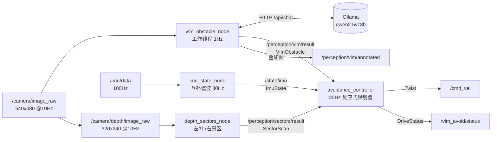

# VLM 视觉避障（ROS2 Humble + Gazebo Classic + Qwen-VL）

用**前置相机 + IMU** 做一个"感知 → 决策 → 执行"闭环：相机图像送本地 Qwen-VL 做语义判断，
IMU 负责姿态/航向估计与倾覆急停，决策结果变成 `/cmd_vel` 控制差速小车。
**不引入激光雷达**，深度相机（RGB-D）只作为可选的高频几何安全网。

> 本仓库已在此机器上完成：**Gazebo 11.10.2 已安装**、6 个 ROS2 包构建通过、**58 个测试通过**、
> **1 个端到端集成测试通过**，并且 **Ollama + Qwen2.5-VL-3B 已装好并用真模型跑通了闭环**
> （CPU 推理下 VLM 判定"红色立方体" → 控制器 `AVOID_LEFT, v=0.10, w=+0.60`）。
> URDF/world 已通过 `gz sdf` 校验（4 个插件 + camera/depth/imu 三个传感器全部识别）。
> 唯一没法在这里做的是**打开 Gazebo 画面**：当前会话没有 GPU 设备节点，`gzserver` 建不出 GLX 上下文。

---

## 0. 新手从这里开始

没接触过 ROS2 / 视觉大模型也没关系：
**[docs/beginner_guide.md](docs/beginner_guide.md)** 用"眼睛—翻译—司机"的比喻把
工程原理、关键代码、**推荐读代码顺序**讲了一遍，还配了 8 张图和 5 个动手实验。

## 1. 先跑起来（3 条命令）

```bash
cd ~/VLN_ws

# ① 装 Gazebo Classic 11 + ROS 插件（需要 sudo 密码；106 个包，约 121 MB）
bash scripts/install_gazebo.sh

# ② 装 Ollama 并拉取 Qwen-VL（两种方式二选一）
bash scripts/setup_vlm.sh              # A. 有 sudo：官方安装脚本 + systemd 服务
bash scripts/install_ollama_noroot.sh  # B. 没 sudo：装到 ~/.local/bin + ~/.ollama，任意终端可用

# ③ 构建 + 跑测试（不需要 GPU，也不需要 Gazebo）
bash scripts/build.sh
bash scripts/run_tests.sh

# ④ 仿真：Gazebo 世界 + 小车 + 完整避障管线 + rviz2
bash scripts/run_sim.sh
```

调试三件套：

```bash
python3 scripts/doctor.py     # 车不动？一键诊断（读 5 秒后给结论）
python3 scripts/probe.py      # 实时看 状态/风险/净空/cmd_vel/VLM判断
bash scripts/teleop.sh        # 手动遥控，验证底盘本身能动能转
```

安装细节与国内网络注意事项见 [docs/setup.md](docs/setup.md)：
Ollama 官方包在国内直连约 95 KB/s，脚本会自动改用加速镜像并强制校验 sha256。

遇到问题先看 [新手导读的 FAQ](docs/beginner_guide.md#9-常见疑问-faq)，
里面有"车不动 / 转圈 / VLM 误报"的标准排查路径。

**什么都不能装时的保底方案**（无 Gazebo、无 GPU 也能看逻辑跑通）：

```bash
bash scripts/run_mock_demo.sh
# 另开终端切场景，观察 /cmd_vel 变化
ros2 topic pub -1 /test/scene std_msgs/String "{data: center}"
ros2 topic echo /vlm_avoid/status
```

---

## 2. 为什么这样设计：VLM 慢，避障要快

直接让大模型"看图出速度"是跑不起来的：3B 模型在 4060 上单帧 0.6~1.5 s，
而避障控制回路需要 20 Hz。所以这里做了**双通道 + 承诺窗口**：

| 通道 | 频率 | 职责 | 失效时 |
|---|---|---|---|
| VLM 语义通道（Qwen-VL） | 1~2 Hz | "那是什么、该往哪让"（语义/可解释） | 标记 `stale`，降级 |
| 深度几何通道（可选 RGB-D） | 10~15 Hz | "离撞上还有多少米"（实时防撞兜底，**会按相机外参剔除地面点**） | 退化为纯 VLM+IMU |
| IMU 状态估计 | 30 Hz | 航向保持（走直线不跑偏）、倾覆急停 | 停车（`require_imu:=true` 时） |
| 反应式规划器 | 20 Hz | 融合上面三路，输出 `(v, ω)`，含状态机/平滑/看门狗 | — |

关键机制：

1. **推理在独立线程**，图像回调只存"最新帧"；单帧在途时**跳过**新帧，避免请求堆积导致延迟雪崩。
2. **承诺窗口（hold_time=1.2s）**：VLM 报一次"前方有障碍"后，即使下一秒它说"通畅"，
   也把避让动作执行完——解决 1 Hz 推理带来的抖动/犹豫。
3. **风险时间衰减**：`risk * exp(-age/τ)`，模型"上一帧看到的"不会永远生效。
4. **风险融合取 max**：语义风险与几何风险谁大听谁的。
5. **侧向推离**：左侧贴墙（0.45 m）但正前方通畅时不做急避让，只轻微回中线，避免"见墙就拐"。
6. **航向保持**：IMU 积分航向 + 比例修正，直行不跑偏；避让结束时重新锁定目标航向，不把车头掰回去。
7. **看门狗**：VLM 掉线 → 有深度就 0.7 倍速继续；没深度就先蠕行 6 s 再停；
   从没收到过任何感知 → 直接停（绝不"盲开"）。
8. **退出时主动发零速度**（真机防"节点死了车还在跑"）。

---

## 3. 架构



包结构：

```
src/
├── vlm_avoid_interfaces/   4 个消息：VlmObstacle / SectorScan / ImuState / DriveStatus
├── vlm_perception/         VLM 客户端、感知节点、深度扇区、Mock 服务、假相机
├── vlm_control/            反应式规划器（纯 Python）、IMU 状态估计、控制节点
├── vlbot_description/      纯 URDF：差速底盘 + RGB 相机 + RGB-D 相机 + IMU
├── vlbot_gazebo/           走廊世界 + 差速/相机/IMU 插件 + spawn 启动
└── vlm_avoid_bringup/      顶层 launch + 参数（avoidance.yaml / tunable.json）+ rviz 配置
tests/integration_mock.py   无 Gazebo 的端到端行为测试
scripts/                    安装、体检、自检、启动、测试
docs/                       架构细节 / 安装排障 / 调参
```

---

## 4. 话题与参数

| 话题 | 类型 | 方向 | 说明 |
|---|---|---|---|
| `/camera/image_raw` | `sensor_msgs/Image` | 入 | 前置 RGB，10 Hz |
| `/camera/depth/image_raw` | `sensor_msgs/Image` (32FC1) | 入 | 可选；没有就 `enable_depth:=false` |
| `/camera_depth/depth/image_raw` | 同上 | 入 | **仿真里用的是这个**（Gazebo 插件按 `camera_name + "/depth/image_raw"` 拼话题），`sim_avoid.launch.py` 已自动覆盖 |
| `/imu/data` | `sensor_msgs/Imu` | 入 | 100 Hz |
| `/perception/vlm/result` | `VlmObstacle` | 内部 | `risk/direction/action/label/stale/latency_ms` |
| `/perception/vlm/annotated` | `sensor_msgs/Image` | 调试 | 把模型判断画在图上，`rqt_image_view` 直接看 |
| `/perception/sectors/result` | `SectorScan` | 内部 | 左/中/右最近距离 |
| `/state/imu` | `ImuState` | 内部 | `roll/pitch/yaw` |
| `/vlm_avoid/status` | `DriveStatus` | 调试 | 当前状态机、风险、净空、看门狗系数 |
| `/cmd_vel` | `geometry_msgs/Twist` | 出 | 20 Hz |

**日常调参只改一个文件**：[`tunable.json`](src/vlm_avoid_bringup/config/tunable.json)。
它按节点分段，覆盖了速度、阈值、VLM 时序、深度外参、IMU 等全部可调项，
改完重启 launch 生效（`--symlink-install` 下直接改 `src/` 里的文件即可）。
优先级：`avoidance.yaml` < `tunable.json` < launch 参数。

常用几个：

| 参数 | 默认 | 作用 |
|---|---|---|
| `vlm_rate_hz` | 1.5 | 每秒推理次数；实际上限 = 1/单帧耗时 |
| `max_side` / `num_predict` | 384 / 96 | 两个最影响推理耗时的旋钮 |
| `keep_alive` | 30m | 模型驻留显存，避免冷启动 |
| `cruise_linear` / `max_linear` | 0.35 / 0.45 | 巡航速度 / 硬上限 |
| `avoid_angular` | 0.85 | 避让角速度（转弯半径 ≈ v/ω ≈ 0.41 m） |
| `stop_distance` / `obstacle_distance` | 0.15 / 0.35 | **0.35 m 开始转向，0.15 m 硬停** |
| `release_margin` | 0.25 | 滞回：退到 0.60 m 才解除避让 |
| `clear_path_distance` | 0.55 | 前方够空时，侧向障碍只转向不减速 |
| `lateral_swerve_max_time` / `_angle` | 1.0 s / 0.4363 rad | 一次侧向避让最多转 **1 s 或 25°**，防止被模型误报带着绕圈 |
| `obstacle_risk_threshold` | 0.70 | 融合风险阈值；正前方障碍另有一票否决 |
| `hold_time` | 1.2 | 避让承诺窗口（防 VLM 抖动） |
| `vlm_stale_timeout` | 3.0 | 多久没结果算过期（自动按 3×延迟放宽） |
| `tilt_estop` | 0.90 | IMU 倾角急停阈值 (rad) |
| `require_imu` | false | 真机建议 true：IMU 不在线不许动 |

完整参数表（含建议范围、公式、三套预设、热改命令）见 [docs/tuning.md](docs/tuning.md)。

运行期改参数不用重启：
```bash
ros2 param set /avoidance_controller cruise_linear 0.2
ros2 param set /vlm_obstacle_node rate_hz 2.0
```

---

## 5. 8GB 显存怎么选模型

| 模型 | 量化后显存 | 4060 单帧延迟 | 建议 |
|---|---|---|---|
| `qwen2.5vl:3b` | ~3.5 GB | 0.6~1.5 s | **默认**，留足显存给 Gazebo/桌面 |
| `qwen3-vl:4b` | ~4 GB | 0.8~2 s | 空间推理更强，允许 1 Hz 时优选 |
| `qwen2.5vl:7b` | ~6.5 GB | 1.5~3 s | 能跑，但和 Gazebo 抢显存容易 OOM |
| 任何模型 + CPU | — | 3~8 s | 驱动没修好时的兜底，链路能通但只适合"走走停停" |

想再快，两个旋钮：`max_side`（512→384）和 `num_predict`（128→96）。
换 vLLM 可把延迟压到 0.2~0.4 s，但 8 GB 下建议 3B-AWQ，见 [docs/setup.md](docs/setup.md)。

---

## 6. 降级矩阵（安全设计）

| VLM | 深度 | IMU | 行为 |
|---|---|---|---|
| 正常 | 正常 | 正常 | CRUISE / AVOID，全功能 |
| 正常 | 缺失 | 正常 | 纯语义避障，保留承诺窗口 + 航向保持 |
| 缺失 | 正常 | 正常 | 0.7 倍巡航，靠几何通道避障，`stale=True` |
| 缺失 | 缺失 | 正常 | 蠕行 6 s 后 STOP |
| 从未收到 | 缺失 | — | 直接 STOP（不盲开） |
| 任意 | 任意 | 倾角 > 0.9 rad | **ESTOP**，立即零速 |

`DriveStatus.state` 取值：`CRUISE / CAUTION / AVOID_LEFT / AVOID_RIGHT / STOP / RECOVERY / ESTOP`。
`STOP` 持续 4 s 会触发 `RECOVERY`（原地转向脱困），避免卡死。

---

## 7. 已验证 vs 待你验证

**已验证（本机实跑）**
- `colcon build`：6 个包全部通过
- 58 个测试：规划器状态机、JSON 容错解析、图像编解码、深度扇区与**地面过滤**、IMU 滤波、
  Mock HTTP 往返、launch 文件可加载、Gazebo 资产（`gz sdf` 转换与 world 校验）
- **真实 Qwen2.5-VL-3B（CPU 推理）+ 真实 ROS 管线**（关闭深度通道，避让只能来自 VLM）：
  - 正前方红箱 → 模型 `{"obstacle": true, "risk": 0.68, "direction": "center", "label": "红色立方体"}`，暖机 3.2 s
  - 控制器 → `AVOID_LEFT, risk=0.45, v=0.10 m/s, w=+0.60 rad/s` ✓
  - 合成场景（纯色几何体）下模型对"通畅"有误报：risk 0.45 → 只降到 `CAUTION 0.20 m/s`，不会急停；真实 Gazebo 纹理场景应更好
- 端到端（假相机 + Mock VLM + 真实 launch/DDS）：
  - 通畅 → `v=0.30 m/s`，`CRUISE`
  - 前方 0.9 m 障碍 → `AVOID_LEFT`，`max|ω|=0.75`，`max v=0.10`，深度扇区识别到 0.9 m
  - 视野恢复 → 回到 `CRUISE` 并继续前进
  - IMU 模拟倾覆 → `ESTOP`，指令严格归零
  - 杀掉 VLM 服务 → `stale=True`，限速 ≤0.21 m/s
  - 调试叠加图正常发布

**待你验证（需要桌面会话）**
- Gazebo 里相机/IMU 插件的**运行时**联调：
  `bash scripts/run_sim.sh` → 应看到 rviz 里小车前进、`/camera/image_raw` 有画面、
  `/odom` 有变化、`/cmd_vel` 随障碍变化。资产本身已用 `gz sdf` 静态校验通过。
- GPU 下的真实延迟：CPU 冷启动 14 s / 暖机 3.2 s，4060 上预计 0.5~1.5 s
  （跑 `bash scripts/run_sim.sh` 后看 `/perception/vlm/result` 里的 `latency_ms`）

**本机实际安装位置**（无需 sudo 的那份）

| 内容 | 路径 |
|---|---|
| Ollama 0.40.5 | `~/.local/bin/ollama` + `~/.local/lib/ollama/`（2.1 GB，sha256 已校验） |
| 模型 `qwen2.5vl:3b` | `~/.ollama/models`（3.0 GB，Ollama 默认目录） |
| 服务 | `127.0.0.1:11434`，任意终端 `ollama serve` 或用 `bash scripts/ollama_serve.sh` |
| PATH | `~/.local/bin`（已写入 `~/.bashrc`，新终端直接 `ollama ...`） |

---

## 8. 排障

### 8.1 "小车不动"怎么查（最常见的问题）

**先明确一点：这条链路不需要你输入任何指令**。感知正常时控制器会自己发 `/cmd_vel`；
不动通常是安全策略在起作用。按这个顺序查：

```bash
python3 scripts/doctor.py
```

它会直接给结论，对应关系如下：

| doctor 输出 | 含义 | 处理 |
|---|---|---|
| `感知完全没进来 → 安全停车` | 相机没图、深度没图、VLM 没结果 | 按设计停车。先 `ros2 topic hz /camera/image_raw`，没图就是 Gazebo 相机插件/渲染问题 |
| `控制器被 enable=false 关掉` | 有人（或 teleop 脚本）关了自动控制 | `python3 scripts/doctor.py --resume` |
| `IMU 倾角超限导致 ESTOP` | 车翻了 / IMU 姿态异常 | 看 `/state/imu` 的 roll/pitch |
| `控制器主动 STOP（净空不足/高风险）` | 感知认为前方不能走 | 看 `/perception/vlm/annotated` 和 `/vlm_avoid/status` |
| `有速度指令但里程没动` | 底盘没响应 | 看 Gazebo 是否 `pause:=true`、差速插件是否加载、spawn 高度 |
| `没有 /odom` | 只在跑 mock（假相机不发里程） | 决策链路正常，底盘未验证 |
| `✓ 一切正常` | 状态、指令、位移都对 | — |

还想单独确认底盘：`bash scripts/teleop.sh`（自动先关控制器，避免两个发布者打架）。

> 常见误判：以为要 `ros2 topic pub /cmd_vel` 才会动。实际上手动发指令会和控制器
> 20Hz 的输出**互相覆盖**，车会抖。要手动控制，先 `--disable`。


| 现象 | 原因 / 处理 |
|---|---|
| `nvidia-smi` 报错 | 驱动没装好：`ubuntu-drivers devices` → `sudo apt install nvidia-driver-XXX` → 重启；期间 Ollama 走 CPU |
| `X Error ... GLX ... X_GLXCreateContext` | 没有可用的 GL 设备：确认 `nvidia-smi` 正常，或用集显跑 Gazebo（`__NV_PRIME_RENDER_OFFLOAD=0`），服务器上装 `xvfb` 后用 `xvfb-run` |
| Gazebo 刷 `Read-only file system: ~/.gazebo` | HOME 不可写（容器/沙箱）：`HOME=/tmp/gz-home gzserver ...` |
| Gazebo 黑屏/崩溃 | 双显卡笔记本常见：`__NV_PRIME_RENDER_OFFLOAD=1 __GLX_VENDOR_LIBRARY_NAME=nvidia gzclient`，或直接用集显跑 Gazebo（VLM 用独显） |
| 没显示器 | `xvfb-run -a bash scripts/run_sim.sh gui:=false`（相机渲染需要 GL 上下文） |
| VLM 一直 `stale` | `ollama list` 看模型在不在；`curl 127.0.0.1:11434/api/tags`；模型名必须和 `model` 参数一致 |
| 单帧 3 s 以上 | 在跑 CPU：确认 `nvidia-smi` 能看到 ollama 进程；或把 `max_side` 降到 384 |
| `VLM 调用失败（连续 N 次）: timeout` | 推理超时。CPU 推理单帧 10~16 s，把 `timeout` 调到 60~120；想真正实时就上 GPU（`bash scripts/ollama.sh ps` 看 PROCESSOR 是否 100% GPU） |
| 车在原地/大圈绕 | VLM 对侧墙误报 `direction=left` + 侧向避让无终止条件。已加"深度佐证 + 转角预算(1 s/25°) + 冷却"；仍绕就调 `lateral_swerve_max_angle` ↓ 或 `side_push_max` ↓ |
| 改了 `tunable.json` 没效果 | 键名拼错会被静默忽略。跑 `python3 -m pytest tests/test_tunable_json.py -q`，它专门检查键名是否存在 |
| 三个扇区距离都是 ~0.5 m、状态一直 STOP | 深度把**脚下地板**当成了障碍。本项目已按相机外参剔除地面点；真机换相机后要改 `camera_height` / `camera_pitch` / `horizontal_fov`（设 `camera_height:=0` 可关闭过滤） |
| `ModuleNotFoundError: No module named 'vlm_avoid_interfaces'` | 没 source 工作区。现在 `scripts/*.py` 会自动 source；若仍报错说明还没 `colcon build` |
| `/odom`、`/imu/data` 有数据但 `/camera/image_raw` 0 Hz | Gazebo 相机插件的话题名不是你以为的那个：ROS2 用 `camera_name`（snake_case）+ `camera_name/image_raw` 拼话题，写 ROS1 的 `cameraName` 会被静默忽略。跑 `python3 scripts/doctor.py` 看"图像话题"那一段的真实名字 |
| 机器人原地打转 | `avoid_angular` 太大或 `hold_time` 太长；先看 `/vlm_avoid/status` 的 `risk/clearance` |
| 不避让直接撞 | 画面里障碍物太小/太远：`stop_distance` 调大，或提高 `vlm_rate_hz`；先看 `/perception/vlm/annotated` 确认模型看到了 |

更多见 [docs/setup.md](docs/setup.md)、[docs/architecture.md](docs/architecture.md)、[docs/tuning.md](docs/tuning.md)。

---

## 9. 下一步可以怎么加

1. **接激光雷达**：`/scan` 替换深度扇区，接 Nav2 的 costmap，VLM 只做"语义标注"（把"人/玻璃门/施工区"写进代价地图）。
2. **VLA 端到端**：Qwen-VL 直接出离散动作 token，用本仓库的状态机做安全层（保底）。这层现在是现成的。
3. **真车**：`use_sim_time:=false require_imu:=true`，把 `/camera/image_raw`、`/imu/data` 换成真实驱动，`/cmd_vel` 接底盘；先低速 `max_linear:=0.15` 跑。
4. **局部建图**：当前 `target_yaw` 只是短时间内保持直线，接 `slam_toolbox` + `nav2` 后可做全局目标导航。
