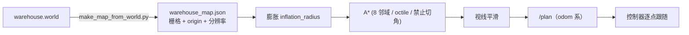

# 架构与决策算法

## 1. 数据流（含时序）

```
 t=0ms    camera(10Hz) ──frame──► vlm_node._on_image  (只存最新帧，丢旧帧)
 t=0ms    depth(10Hz)  ────────► depth_sectors_node   (10ms 内算完三扇区)
 t=0ms    imu(100Hz)   ────────► imu_state_node       (30Hz 输出姿态)
 t=~1s    vlm worker   ──HTTP──► Ollama               (3B 量化 ≈0.6~1.5s)
 t=~1s    vlm_node     ──VlmObstacle──► controller
 t=20Hz   controller   ──Twist──► /cmd_vel
```

关键约束：**控制回路的周期（50 ms）必须与模型延迟（600~1500 ms）解耦**。
因此：

- `vlm_node` 的图像回调永不阻塞（只更新 `self._frame` + `Event.set()`）；
- 推理线程严格按 `1/rate_hz` 节拍跑，未到节拍不推理（这一点曾经写错过，被 10 Hz 图像事件
  拖着跑成了 10 Hz，日志里能明显看出来）；
- 单帧在途时不再发新请求（`max_inflight=1` 的隐式实现：线程串行 + 只取最新帧）。

## 2. 感知层

### 2.1 VLM 通道（语义）

输入：640×480 BGR → 长边缩到 512 → JPEG q=72 → base64。
提示词要求严格 JSON，并启用 Ollama 的 `format=json`（结构化输出），
再用 `extract_json` 做三层容错：直接解析 → 去 markdown 围栏 → 花括号配对扫描。

`normalize_result` 做防御性归一：

| 情况 | 处理 |
|---|---|
| `risk` 越界 / NaN / 字符串 | clamp 到 [0,1]，无法解析则 0 |
| `direction` 用中文/同义词 | 映射到 `left/center/right/none` |
| 说"有障碍"但方向 `left`+动作 `go_straight` | 动作改成 `turn_right` |
| 说"前方有障碍"但动作 `go_straight` | 改成 `stop`（最保守） |
| 说"没障碍"却给 `risk=0.9` | 动作归位直行，`risk` 压到 ≤0.3 |
| 解析失败 / HTTP 错 / 超时 | 发布 `stale=true`，`risk=max(EMA, 0.6)`，`action=stop` |

注意最后一条：**失败也要发布**。下游必须能区分"真的通畅"和"我不知道"。

### 2.2 深度 + 激光雷达（几何双通道）

| | 深度相机 | 激光雷达 |
|---|---|---|
| 视场 | 水平约 68°（1.2 rad） | **360°** |
| 高度 | 能看到地面与低矮物体 | 单平面（0.21 m），看不到矮台阶 |
| 抗干扰 | 受光照/纹理影响 | 不受光照影响 |
| 用途 | 前方三维净空、地面过滤 | 侧后方全向防撞、贴墙判断 |

两者都经 `compute_sectors / compute_scan_sectors` 转成同构的 `SectorScan`，
控制器逐项取 **min**：谁更保守听谁的。任一路失效只是少一个约束，不会让车"看不见"。

### 2.3 深度通道（几何）

深度图按列切三个扇区（0–33%、33–67%、67–100%），对每扇区取有效像素的 **10 分位**距离：

- 用分位数而非 min，抗飞点/噪声；
- 用低分位而非均值，保证对贴脸障碍敏感；
- 无效值（0/NaN/超量程）先过滤，有效像素不足 5% 则该扇区记 `max_range`。

这一路 10 Hz、耗时 < 10 ms，是 VLM 缺席时的实时安全网。**它不是激光雷达**，仍然是相机。

#### 必须剔除地面（实测踩坑）

前置相机一定看得到脚下地板，而地板永远比障碍物近。直接对画面取 10 分位会得到 ~0.5 m
的"假障碍"：三向净空都是 0.51 m → `geo_risk=1` → 控制器永远 STOP，车一动不动。

以 vlbot 为例（相机高 0.16 m、下俯 5°、vfov≈0.95 rad）：图像中心的射线打到 1.8 m 处的
地面，最下沿只有 0.30 m。也就是说画面下半部分几乎全是地板。

解决办法是按外参把像素反投影出高度并过滤：

```
beta(v) = camera_pitch + atan((v - cy) / fy)      每行光线相对水平面的俯角
height  = camera_height - depth · sin(beta)       该点离地高度
丢弃 height < ground_clearance (默认 0.06 m) 的像素
```

替换参数：`camera_height`、`camera_pitch`、`horizontal_fov`（`vertical_fov` 默认由 hfov 与
宽高比换算）、`ground_clearance`。单测 `test_floor_filtering_recovers_obstacle` 守着这个行为。

### 2.4 IMU 通道（状态估计）

互补滤波：`angle = α(angle + ω·dt) + (1-α)·angle_acc`，α=0.98，分别对 roll/pitch 做。
yaw 只靠陀螺积分（无磁力计），并在静止时估计零偏，因此**只用于短时航向保持**，不用于定位。

跌倒检测的坑：α=0.98 时纯加速度计修正要 1.5 s 才收敛，急停来不及。
所以加了 `snap_threshold=0.5 rad`：当加速度计姿态与预测值偏差超过阈值，直接把估计值
向测量值拉一半，2~3 帧（≈0.1 s）即可识别跌倒。这条有单测覆盖
（`test_complementary_filter_fast_tilt_detection`）。

## 3. 决策层：反应式规划器

纯 Python 类 `ReactivePlanner`，不依赖 ROS，可离线单测（54 个测试里 21 个是它）。

### 3.1 每帧计算顺序

```python
1. IMU 倾角 > tilt_estop          -> ESTOP（最高优先级，指令归零）
2. 融合风险：
   risk_vlm = vlm_risk · e^(-age/τ)      （仅当 vlm_ok；τ=max(2.5s, 2×推理延迟)）
   geo_risk  = (slow_d - center) / (slow_d - stop_d)
   risk      = max(risk_vlm, geo_risk)
   无任何感知 -> risk = unknown_risk(0.35) 且立即 STOP
3. 速度上限：
   cap = cruise_linear
   cap = min(cap, (center - stop_d) · 0.9)          # 深度净空
   cap = min(cap, cruise_linear·(1 - 0.85·risk))    # 风险减速
   （侧向障碍且 center > clear_path_distance 时：只用几何风险，不减速）
   感知降级：无深度 -> stale_creep；有深度 -> 0.7·cruise
4. 是否有障碍：risk ≥ 0.70 或 center < 0.35（滞回解除 0.60）
   或模型明确说 direction=center（正前方一票否决）
5. 选边（左右哪边空）：
   承诺窗口内沿用上次选择（只要那侧仍 ≥ turn_min_clearance），避免每帧翻转
   深度：两侧都 < turn_min_clearance（0.35） -> 0（停）
         左 > 右+margin -> +1（左转）；右 > 左+margin -> -1
         两侧都够宽 -> 语义方向 > 语义动作 > prefer_side
   无深度：障碍在左 -> 右转；在右 -> 左转；正前 -> 看 action，stop 则停
6. 承诺窗口：一旦选出 side，hold_time 内即使"通畅"也继续执行
7. 执行：
   有 side  -> ω = side·avoid_angular·(0.55+0.45·risk/0.8)，v = min(cap, creep)
   无障碍   -> v = cap；ω = 航向保持 + 侧向推离
   有障碍无边 -> v=ω=0（STOP），持续 recovery_after 后进入 RECOVERY
8. 平滑：v,ω 一阶低通（α=0.45）；STOP/ESTOP/RECOVERY 不平滑；
   AVOID -> CRUISE 切换时角速度直接交给航向保持（避免过冲）
9. 限幅：|v| ≤ max_linear，|ω| ≤ max_angular
```

### 3.2 状态机

| 状态 | 进入条件 | 输出 | 退出 |
|---|---|---|---|
| `CRUISE` | 无障碍且 risk<0.15 | `v=cap`, `ω=航向保持` | 出现障碍 |
| `CAUTION` | 无障碍但 0.15≤risk<0.45 | 同 CRUISE，速度被压 | risk 降低 |
| `AVOID_LEFT` / `AVOID_RIGHT` | 有障碍且存在较空的一侧 | `v≤creep`, `ω=±0.75·k` | 障碍消失且承诺窗口结束 |
| `STOP` | 有障碍但两侧都不安全 | 0,0 | 4 s → `RECOVERY` |
| `RECOVERY` | STOP 超时 | `v=-0.06`, `ω=±0.7` 原地脱困 1.5 s | 超时回主循环重新评估 |
| `ESTOP` | IMU 倾角超限 | 0,0 | 姿态恢复 |

### 3.3 慢推理的坑：衰减常数必须跟着延迟走

最初 τ 固定 2.5 s。用 CPU 跑真模型（14~16 s/帧）时发现：模型刚报完"前方有红色立方体"，
控制器读到时风险已经被衰减成 0，语义通道等于失效——表现就是"模型明明看到了却不躲"。

现在 τ = max(2.5, 2×latency)。1 Hz 的 GPU 推理行为不变；十几秒一帧的 CPU 推理也能保住判断。
同理，`vlm_ok` 的陈旧阈值也放宽为 `max(vlm_stale_timeout, 3×latency)`，
而模型真的挂掉时节点会发 `stale=True`，仍然会被判为不可用。

### 3.4 为什么"承诺窗口"是必须的

VLM 1 Hz + 随机性 → 相邻两帧可能给出相反判断。没有 hold_time 时，机器人会
"转一下—回正—再转一下"，在窄通道里表现为画龙。hold_time=1.2 s 让一次避障至少执行
1.2 s，等于给了底盘完成转向的时间。代价是反应略迟钝，可以用 `avoid_angular` 补偿。

### 3.5 目的地导航（goto 模式）

控制器订阅 `/goal_pose` 与 `/odom`，用里程计算：

```
dx, dy  = 目标 - 当前位置
dist    = hypot(dx, dy)
bearing = wrap(atan2(dy, dx) - 当前朝向)
```

规划器在**没有障碍**时进入 `GOTO`：

```
ω = clamp(goal_kp · bearing, ±goal_max_angular)
align    = max(0, 1 - |bearing| / goal_slow_angle)      # 角度大就先原地转
approach = min(1, max(0.25, dist / goal_slow_radius))   # 近了减速
v = cap · align · approach
```

`dist ≤ goal_tolerance` 时输出 `ARRIVED` 并停车。

**避障始终优先**：一旦检测到障碍，状态机照常进入 `AVOID_*` / `STOP`，
障碍解除后自动回到 `GOTO`。所以它是"朝着目标走、遇事自己绕"，不是全局路径规划——
目标在隔墙后面时会卡在墙前（需要 Nav2/SLAM 才有真全局规划）。

### 3.6 A* 全局路径（解决"墙后面到不了"）

`GOTO` 只是"朝目标直着走 + 本地绕障"，目标在墙后就会顶着墙蹭。所以加了一层全局规划：



**地图从哪来**：`scripts/make_map_from_world.py` 解析 SDF，把静态模型的
`box/cylinder/sphere` 碰撞体栅格化（0.1 m/格）。`plane`（地面）和"只有 visual
没有 collision"的模型（目标点标记）不会进图——这一点和激光雷达看到的一致。

**坐标怎么对齐**：地图是世界坐标，而 `/odom` 从出生点算起。节点用
`map_offset_x/y`（= 出生点世界坐标，launch 自动从 `x:=`/`y:=` 传入）做平移，
发布出去的 `/plan` 已经在 odom 系。

**膨胀**：按机器人半径 + 余量（默认 0.28 m）做圆形膨胀，而不是方形，避免把窄通道堵死。

**A\***：8 邻域，直走 1、斜走 √2，octile 启发；斜向移动时要求两个正交邻居都空
（禁止"切角"穿过两个障碍的接缝）；起点/终点落在障碍里时先吸附到最近空格。

**平滑**：贪心视线法（能直连就跳过中间点），把几十个格子压成 4~6 个路点。

**跟随**：控制器订阅 `/plan`，每 50 ms 取"第一个距自己超过 `waypoint_tolerance`（0.35 m）
的路点"作为当前目标；到达判定仍然用**最终目标**的距离。本地避障始终优先——
路上有障碍照常 `AVOID/STOP`，解除后回到路径。

**重规划**：收到新目标立即重算，之后每 `replan_period`（2 s）按当前位置重算一次
（成本很低：276x196 栅格，一次 A* 约几十毫秒）。

**局限**：地图是静态的。运行中新出现的障碍（比如移动的人）只能靠本地避障躲，
A* 不会为它改路线。要做动态规划，得把激光雷达接进代价地图并标记脏区。

### 3.7 定位与坐标系（地图为什么会对不上）

仿真里最容易踩的坑：**RViz 里的车和 Gazebo 里的车越走越偏，A* 路径看着穿墙**。

原因不是地图画错了，而是**位姿来源**：

| 来源 | 精度 | 问题 |
|---|---|---|
| 差速插件（轮式里程计） | 靠轮速积分 | 撞墙、打滑、被推一下就漂，越走越偏 |
| `gazebo_ros_p3d`（真值） | 精确 | 只发 Odometry，不发 TF |

所以现在的接法是：

```
gazebo_ros_p3d ──/ground_truth/odom──► ground_truth_odom ──/odom + TF(odom→base_footprint)──► 控制器/A*/rviz
diff_drive     ──/wheel_odom──────────► 只用于打印漂移，不参与控制
```

`ground_truth_odom` 把世界坐标换算成"相对出生点"的 odom 坐标：

```
local = R(-origin_yaw) · (world - origin)
```

`origin` 就是出生点（launch 的 `x:=`/`y:=`/`yaw:=`），所以 `map_offset_x/y` 保持不变、
地图与 Gazebo 严格对齐。节点每 5 秒打印一次轮式里程计的漂移量——真机上这个差值
就是需要 SLAM/AMCL 修正的部分。

> 真机没有真值：要么用 `robot_localization` 的 EKF（轮速 + IMU），
> 要么用 SLAM/AMCL 把 `/odom` 修正到 `/map`。本项目的接口不变，替换位姿来源即可。

## 4. 执行层

`avoidance_controller` 20 Hz 定时器统一出口，保证：

- 所有安全约束（限幅、急停、看门狗）都在一个地方收口；
- 输入全部带时间戳，任何超时都按"缺失"处理（不会用 10 s 前的数据开车）；
- `destroy_node()` 主动发一次零速度，真机断电/CTRL-C 时不会残留速度。

## 5. 消息定义

```text
VlmObstacle { header, obstacle, risk, direction, action, label,
              confidence, stale, latency_ms, raw_text }
SectorScan  { header, valid, left, center, right, min_range }
ImuState    { header, roll, pitch, yaw, yaw_rate, valid }
DriveStatus { header, linear_cmd, angular_cmd, state, risk,
              clearance_center, yaw, vlm_stale, watchdog_scale }
```

设计原则：**调试信息（latency/stale/raw_text）跟着结果一起走**，
这样 `ros2 topic echo` 就能诊断"是模型慢、模型错、还是控制器错"。
