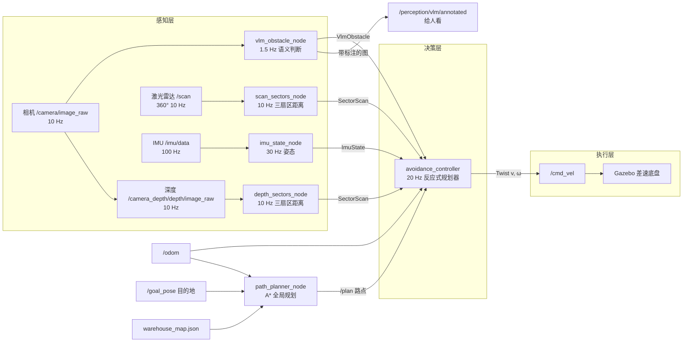
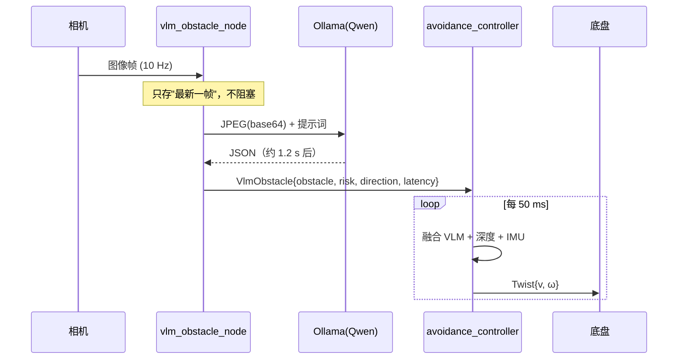
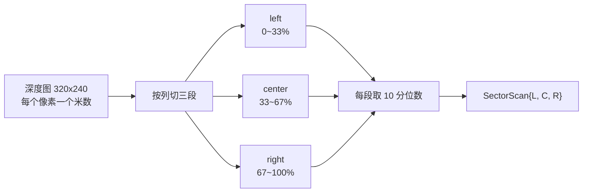
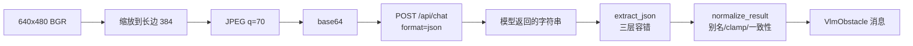
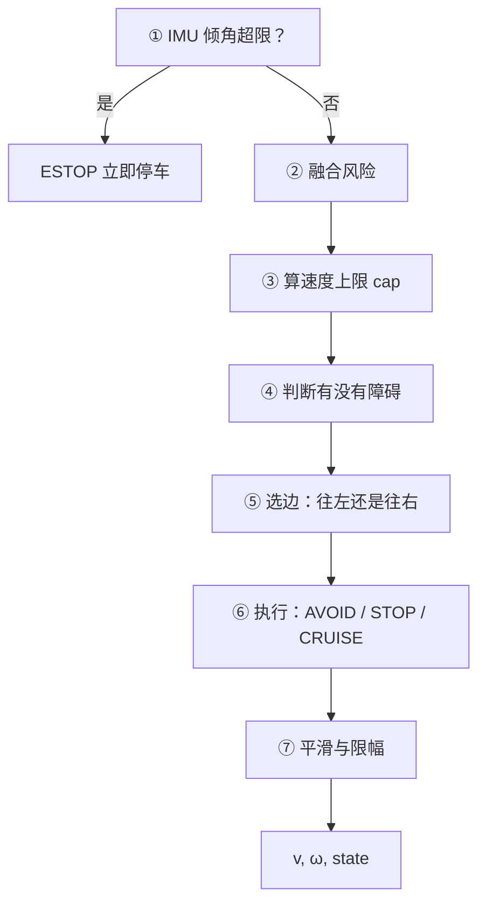
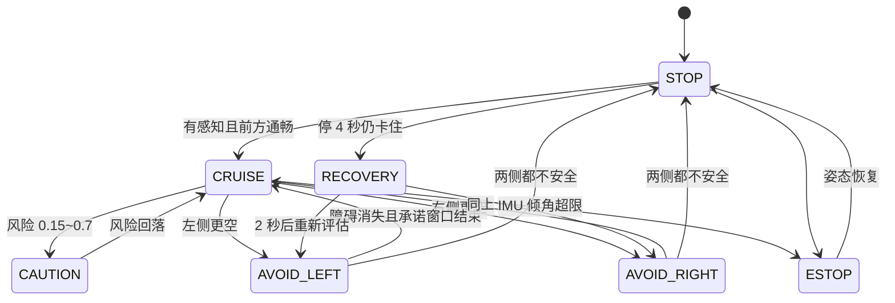
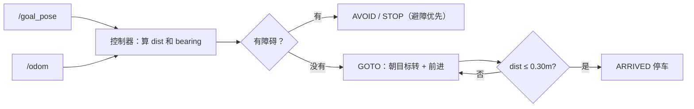
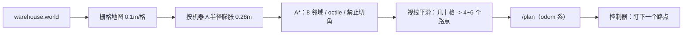

> 先看 [project_guide.md](project_guide.md)（运行/参数/阅读路径）；
> 这份是**原理向**的深入讲解，配套读。

# 新手导读：从零读懂这个视觉避障工程

> 读完这份文档，你应该能回答三个问题：
> ① 一张相机图片是怎么变成车轮转速的？② 为什么大模型不能直接开车？③ 想改行为应该动哪一行？
>
> 全文按"先讲人话、再给图、最后贴代码"的顺序组织。代码位置都给了行号链接，可以直接点开对照。

---

## 0. 先用一句话理解它

> **相机是眼睛，Qwen-VL 是翻译，规划器是司机，`/cmd_vel` 是方向盘。**

- **眼睛**（相机）每秒看 10 次，看到的是像素。
- **翻译**（Qwen-VL）每秒看 1 次，把像素翻译成一句人话：
  `{"obstacle": true, "direction": "left", "risk": 0.7, "label": "红色的箱子"}`
- **司机**（规划器）每秒想 20 次，把"左边有东西"翻译成"方向盘往右打 0.6 弧度"。
- **方向盘**（`/cmd_vel`）接收 `v`（前进速度，m/s）和 `ω`（转向角速度，rad/s）。

再补一个**触觉**：深度相机每 0.1 秒量一次"前面还有多少米"，IMU 每 0.01 秒量一次"车身歪没歪"。

### 0.1 为什么不让大模型直接开车？

这是整个工程最重要的设计决策。先看对比：

| | 让 VLM 直接输出速度 | 本项目：VLM 只做语义，规划器出速度 |
|---|---|---|
| 反应频率 | 1~2 Hz（单帧 0.5~2 s） | 20 Hz |
| 抖动 | 相邻两帧结论可能相反，车会画龙 | 有承诺窗口 + 平滑，动作连续 |
| 安全兜底 | 模型说"通畅"就直接撞 | 深度通道 10 Hz 独立防撞 |
| 可解释性 | 只有一个数字 | 状态机 + `/vlm_avoid/status` 可查 |
| 出错影响 | 直接撞车 | 最多"这一帧判断不可信"，被过滤掉 |

一句话：**大模型负责"是什么"，小算法负责"多近、多快、往哪打"。**

### 0.2 ROS2 概念小抄（30 秒）

| 概念 | 人话 | 本工程里的例子 |
|---|---|---|
| 节点 node | 一个干活的程序 | `vlm_obstacle_node`、`avoidance_controller` |
| 话题 topic | 广播频道，谁都能听 | `/camera/image_raw`、`/cmd_vel` |
| 消息 message | 频道里传的结构体 | `sensor_msgs/Image`、`Twist` |
| 参数 param | 运行时能改的配置 | `cruise_linear`、`obstacle_distance` |
| launch | 一键启动多个节点的脚本 | `sim_avoid.launch.py` |
| QoS | 传输质量（可靠 / 尽力而为） | 相机用 best_effort，控制指令用 reliable |

单位统一为：米（m）、米/秒（m/s）、弧度（rad）、弧度/秒（rad/s）、赫兹（Hz，每秒几次）。

---

## 1. 全局地图：一次决策是怎么发生的

### 1.1 系统总览



### 1.2 四个频率角色对照

| 角色 | 频率 | 一次要多久 | 负责什么 | 它挂了会怎样 |
|---|---|---|---|---|
| 相机 / 深度 | 10 Hz | 100 ms | 提供原始画面 | 直接停（看不到路） |
| 深度扇区 | 10 Hz | < 10 ms | 前方左/中/右还有几米 | 只靠雷达，行为不变 |
| 激光雷达 | 10 Hz | < 5 ms | **360°** 左/中/右还有几米 | 只靠深度，行为不变 |
| VLM | 1.5 Hz | 1~2 s | 那是什么、要不要躲 | 标记 stale，靠深度继续走 |
| 规划器 | 20 Hz | < 1 ms | 出 `v`、`ω` | 车停（没人发指令） |
| IMU | 100 Hz | 10 ms | 姿态、航向 | 航向保持失效；`require_imu` 时会停 |

**关键洞察**：最慢的 VLM（1~2 秒）和最需要快的避障（50 毫秒）差了两个数量级。
所以架构上必须有一条**不经过 VLM 的快速通道**——那就是深度扇区。

### 1.3 一次完整决策的时序



注意两条时间线是**交错**的：VLM 还在算的时候，控制器已经发了 24 帧指令了。

---

## 2. 感知层 A：深度几何（建议第一个读）

### 2.1 它在解决什么问题

相机图片只有颜色，没有距离。深度相机每个像素额外给一个"离相机多少米"的浮点数。
我们要把它压缩成 3 个数字：**左边最窄多少米、中间最窄多少米、右边最窄多少米**。



### 2.2 两个必须懂的坑

**坑 1：为什么用"10 分位数"而不是最小值？**
深度图有噪声和飞点（偶尔蹦出一个 0.05 m 的假点）。取最小值会被一个坏点带偏；
取平均值又会掩盖真正的近距离障碍。**10 分位数** = 忽略最靠前的 10% 坏点，又仍然对近处敏感。

**坑 2：为什么必须剔除地面？**（这个坑真的踩过）

前置相机一定看得见脚下的地板，而地板永远比障碍物近：

```
             相机 (高 0.16 m，下俯 5°)
                \
                 \  ← 视线中心打到 1.8 m 处的地面
                  \
    ───────────────\──────────────────  地面
        0.30 m      1.8 m
        ↑ 画面最下沿
```

如果整幅图一起取分位数，结果会被地板主导，读出 **0.5 m 的假障碍**，于是车永远不敢走。
解法是按相机外参把每个像素反投影出高度，把贴着地面的点扔掉：

```
beta(v) = camera_pitch + atan((v - cy) / fy)     第 v 行光线的俯角
height  = camera_height - depth · sin(beta)      这个点离地多高
height < ground_clearance (0.06 m) -> 判定为地面，丢弃
```

### 2.3 关键代码

文件：[depth_sectors.py](../src/vlm_perception/vlm_perception/depth_sectors.py)，函数从 [第 19 行](../src/vlm_perception/vlm_perception/depth_sectors.py#L19) 开始。

```python
# 1) 按行算出每行光线的俯角（只在给了相机外参时才做）
cy = (h0 - 1) / 2.0
fy = (h0 / 2.0) / math.tan(vfov / 2.0)
rows = np.arange(h0, dtype=np.float32).reshape(-1, 1)
theta_row = np.arctan((rows - cy) / fy) + camera_pitch

# 2) 基础有效性：NaN / Inf / 0 / 负 / 超量程 都不算
valid_mask = np.isfinite(d) & (d > 0.05) & (d <= max_range)

# 3) 地面过滤：点离地高度低于阈值就丢掉
if theta_row is not None:
    heights = camera_height - d * np.sin(theta_row)
    valid_mask &= heights > ground_clearance

# 4) 三段分别取 10 分位
for name, (c0, c1) in bands.items():
    vals = d[:, c0:c1][np.isfinite(...)]
    out[name] = float(np.percentile(vals, percentile))
```

**逐行要点**：
- 第 1 段只算一次，之后广播到所有列（`(h,1)` 对 `(h,w)` 自动广播）——这是 numpy 的省事写法。
- 第 2 段的 `d > 0.05` 是"比最近量程还近的值视为无效"，避免除零/噪声。
- 第 3 段是核心：`camera_height - d·sin(beta)` 就是"这个点比相机低多少"，等于离地高度。
- 第 4 段的 `min_valid_ratio` 是个保护：某个扇区有效像素太少时，直接报告"很远"。

---

## 2.5 感知层 A'：激光雷达（比深度更简单）

雷达给出的是"一圈 720 个角度上各有多远"，把它按角度分成三段就行：

```python
front = 有效 & (|angle| <= 20°)        # 正前方
left  = 有效 & (20° < angle <= 100°)   # 左侧
right = 有效 & (-100° <= angle < -20°) # 右侧
center = min(ranges[front])            # 每一段取最小值
```

代码在 [scan_sectors.py](../src/vlm_perception/vlm_perception/scan_sectors.py)，比深度还短。
两个关键点：

- **无效值**：激光雷达没打到东西时返回 `inf`，必须先用 `isfinite` 过滤；
- **角度包裹**：360° 雷达的 `angle_min` 通常是 `-π`，扫描到 `+π` 要包回 `[-π, π]`，
  否则正后方会被算成"正前方"。

**为什么要和深度同时用？** 两者互补：

| | 深度相机 | 激光雷达 |
|---|---|---|
| 视场 | 约 68° | **360°** |
| 高度 | 能看到地面/矮物体 | 只有一个平面（0.21 m） |
| 受光照影响 | 会 | 不会 |

控制器把两路的三扇区**逐项取最小值**，谁更保守听谁的。

---

## 3. 感知层 B：VLM 语义

### 3.1 一次推理的流水线



### 3.2 提示词为什么写成这样

看 [vlm_client.py 第 21 行左右](../src/vlm_perception/vlm_perception/vlm_client.py#L21)：

```python
'1. 只考虑"会挡住你继续前进"的实体（前方的箱子、椅子、行人、正对着的长墙等）。'
'   两侧的墙、走廊侧壁、地面、天花板、远处背景都不算障碍物——你是在走廊里行驶。'
'2. risk 表示"保持当前直行会撞上的可能性"，不是"离得近"。'
'   只在画面左/右边缘出现的侧向物体，risk 不要超过 0.4。'
```

三个教学点：
1. **给场景**（"你是在走廊里行驶"）比单说"找障碍物"准得多；
2. **给反例**（两侧的墙不算）——3B 模型很容易把侧墙当障碍，这是实测踩的坑；
3. **定义 risk 的语义**（撞上的可能性 ≠ 距离近），否则模型看到近处的东西就给 1.0。

另外代码强制 `format: "json"`，让 Ollama 做结构化输出约束，减少"模型输出一段解释"的概率。

### 3.3 模型输出不可信，所以有三层容错

```python
# 第 1 层：直接解析
# 第 2 层：去掉 markdown 的 json 代码围栏再解析
# 第 3 层：花括号配对扫描（模型常在 JSON 前后加解释）
obj = extract_json(raw_text)
```

拿到 dict 后还要归一化（[normalize_result，第 166 行](../src/vlm_perception/vlm_perception/vlm_client.py#L166)）：

| 模型可能输出 | 归一化后 |
|---|---|
| `direction: "左"` | `"left"` |
| `risk: 1.7` | `1.0`（clamp） |
| 说"有障碍"但没给方位 | `direction = "center"` |
| `direction: left` + `action: turn_left`（朝障碍转） | `action = "turn_right"` |
| 说"没障碍"却给 risk 0.9 | 直行，risk 压到 ≤ 0.3 |

### 3.4 工作线程：为什么要单独开一条线程

ROS2 的回调在 executor 里串行执行。如果直接在图像回调里调模型（1.2 秒），
这 1.2 秒内**所有其他回调都会堵住**，控制节点也会跟着卡。

所以拆成：图像回调只做"存最新帧 + 打个标记"，推理放在独立线程（[vlm_node.py:124](../src/vlm_perception/vlm_perception/vlm_node.py#L124)）：

```python
def _loop(self):
    next_t = time.monotonic()
    while not self._stop.is_set():
        period = 1.0 / max(0.05, self.rate_hz)   # 节流：每秒最多几次
        now = time.monotonic()
        if now < next_t:                          # 还没到点，只等不推理
            self._new_frame.wait(timeout=min(next_t - now, 0.1))
            continue
        if not self._new_frame.is_set():          # 到点了但没新帧
            self._new_frame.wait(timeout=0.1)
            continue
        self._new_frame.clear()
        seq, bgr, stamp = self._frame             # 只取最新一帧
        self._infer(seq, bgr, stamp)
        next_t = time.monotonic() + period        # 推理完再排下一次
```

两个细节值得记住：
- **单帧在途**：线程串行执行，天然保证上一帧没回来就不会发下一帧，避免请求堆积。
- 这里曾经写错过：如果直接在"有帧就推理"，10 Hz 的相机事件会把推理拖着跑到 10 Hz，
  日志里能明显看出来（节流失效）。修法就是上面这个 `next_t` 节拍。

### 3.5 失败也要发布消息

模型超时/连不上时，`_publish_failure` 会发一条 `stale=true` 的消息。
**为什么？** 因为"没有消息"和"我判断这里通畅"在下游看起来可能一样，
但前者意味着你不知道发生了什么。用 `stale` 明确表达"我不知道"，下游才能降级。

---

## 4. 决策层：反应式规划器（核心，值得多花时间）

### 4.1 它长什么样

一个**不依赖 ROS 的纯 Python 类**（[planner.py:115](../src/vlm_control/vlm_control/planner.py#L115)），
输入是一个 dataclass，输出也是一个 dataclass：

```python
class ReactivePlanner:
    def update(self, inp: PlannerInputs) -> PlannerOutputs: ...
```

这么做的好处：可以脱离 ROS 单独跑单元测试（21 个测试），改算法时几毫秒就能验证。

输入（[PlannerInputs:79](../src/vlm_control/vlm_control/planner.py#L79)）：

| 字段 | 含义 | 谁给的 |
|---|---|---|
| `vlm_ok` / `vlm_age` / `vlm_latency_s` | 语义结果是否新鲜、多久之前、推理多慢 | 控制节点从 VlmObstacle 算出来 |
| `vlm_obstacle` / `vlm_risk` / `vlm_direction` / `vlm_action` | 语义判断 | VLM 节点 |
| `sectors_valid` / `left` / `center` / `right` | 三向净空 | 深度节点 |
| `imu_valid` / `roll` / `pitch` / `yaw` | 姿态 | IMU 节点 |
| `now` / `dt` | 时间戳与周期 | 控制节点 |

输出（[PlannerOutputs:104](../src/vlm_control/vlm_control/planner.py#L104)）：
`linear`、`angular`、`state`、`risk`、`clearance_center`、`watchdog_scale`、`note`。

### 4.2 `update()` 的七个步骤



代码从 [第 194 行](../src/vlm_control/vlm_control/planner.py#L194) 开始，按顺序读即可。

#### ① 倾覆急停（最高优先级）

```python
if inp.imu_valid and max(abs(inp.roll), abs(inp.pitch)) > p.tilt_estop:
    return self._emit(inp, 0.0, 0.0, 'ESTOP', 1.0, inp.center, 0.0, 'IMU 姿态超限')
```

车身歪超过 0.9 rad（约 52°）就立刻停。这一条放在最前面，因为它不该被任何逻辑覆盖。

#### ② 融合风险：语义和几何取最大值

```python
risk_vlm_eff = risk_vlm if vlm_actionable else 0.0
if lateral_only:
    risk = geo_risk if has_depth else 0.0     # 侧向障碍不参与减速
elif has_depth:
    risk = max(risk_vlm_eff, geo_risk)        # 谁大听谁的
else:
    risk = risk_vlm_eff
if center_block:
    risk = max(risk, 0.7)                     # 正前方有东西，风险兜底 0.7
```

**为什么取 max 而不是平均？** 安全策略要保守：深度说"1.2 m 有东西"、模型说"通畅"，
这时候应该相信"有东西"。平均会把风险摊薄到 0.3，车就不躲了。

#### ③ 速度上限：三个约束取最小

```python
cap = p.cruise_linear
if has_depth:
    cap = min(cap, max(0.0, (inp.center - p.stop_distance) * 0.9))   # 距离约束
if risk > 0.0:
    cap = min(cap, p.cruise_linear * (1.0 - 0.85 * risk))            # 风险约束
cap = max(0.0, min(cap, p.max_linear))                               # 硬上限
```

代入默认值看几个点（`cruise=0.35`、`stop=0.15`、`slow=0.80`）：

| 前方净空 | 几何风险 | 输出速度 |
|---|---|---|
| 2.0 m | 0.00 | 0.35（巡航） |
| 0.8 m | 0.00 | 0.35（还没到减速点） |
| 0.5 m | 0.46 | 0.21 |
| 0.3 m | 0.77 | 0.12 |
| ≤0.15 m | 1.00 | 0 |

#### ④ 判断"有没有障碍"

```python
obstacle = risk >= p.obstacle_risk_threshold or center_block
if has_depth:
    if inp.center < p.obstacle_distance:                 # 0.35 m 触发
        self._near = True
    elif inp.center > p.obstacle_distance + p.release_margin:  # 0.60 m 才解除
        self._near = False
    obstacle = obstacle or self._near or lateral_only
```

最后那个 `release_margin` 叫**滞回**：如果没有它，车会在 0.35 m 附近
"触发避让 → 退开一点 → 解除 → 又靠近 → 再触发"，一秒钟抖好几次。
用一个"进入阈值"和"退出阈值"，行为就稳定了。

#### ⑤ 选边：往左打还是往右打

```python
def _choose_side(self, inp, has_depth, risk, now):
    # 承诺窗口内沿用上次选择（只要那一侧还够空）
    if self._commit_side != 0 and now < self._commit_until:
        clearance = inp.left if self._commit_side > 0 else inp.right
        if (not has_depth) or clearance >= p.turn_min_clearance:
            return self._commit_side

    if has_depth:
        if left < turn_min_clearance and right < turn_min_clearance:
            return 0                                   # 两边都太窄：停
        if left > right + side_margin:  return 1       # 左边更空：左转
        if right > left + side_margin:  return -1      # 右边更空：右转
        # 两边差不多：听语义，再不行用默认偏好
    # 没有深度时：障碍在左就右转，在右就左转
```

**约定**：`+1` 是向左（正角速度，逆时针），`-1` 是向右。障碍在左边，就往右转（`-1`）。

**承诺窗口**是这里最重要的设计：一旦选定一侧，`hold_time`（1.2 s）内不再改变主意。
没有它，VLM 每帧结论不同、深度噪声在阈值附近抖动，会导致每帧翻向，
平滑之后角速度互相抵消——车看起来在原地磨，实际一点没转。

#### ⑥ 执行：三种情况

```python
if side != 0 and (obstacle or now < self._commit_until):
    angular = side * p.avoid_angular * (0.55 + 0.45 * min(1.0, risk / 0.8))
    linear = cap if lateral_only else min(cap, p.creep_linear)
    state = 'AVOID_LEFT' if side > 0 else 'AVOID_RIGHT'
elif obstacle:
    linear, angular, state = 0.0, 0.0, 'STOP'      # 无路可走
else:
    linear = cap
    state = 'CRUISE' if risk < 0.15 else 'CAUTION'
```

注意避让时速度被压到 `creep_linear`（0.12 m/s）——**除非**是"侧向障碍且前方通畅"，
这时保持巡航速度边开边让（`lateral_only`）。

#### ⑦ 平滑与限幅

```python
smooth_lin = a * linear + (1.0 - a) * self._prev_linear       # 一阶低通
smooth_ang = a * angular + (1.0 - a) * self._prev_angular
linear = clamp(linear, -max_linear, max_linear)                # 再硬限幅
```

平滑让指令连续、不突变；限幅保证任何分支算错都不会超过物理上限。

### 4.3 状态机全貌



### 4.4 四个"防抖/防呆"设计，理解了它们就理解了这个项目

| 设计 | 参数 | 解决的问题 |
|---|---|---|
| **风险时间衰减** | `vlm_risk_tau` | 3 秒前看到的东西不该永远生效 |
| **承诺窗口** | `hold_time` | 模型每帧结论不同，导致左右横跳 |
| **滞回** | `obstacle_distance` + `release_margin` | 在阈值附近反复触发/解除 |
| **侧向避让预算** | `lateral_swerve_max_angle/time` | 模型误报侧墙导致一直转圈 |

侧向避让预算的规则值得单独看（[planner.py:222](../src/vlm_control/vlm_control/planner.py#L222)）：

```python
lateral_claim = (vlm_obstacle and direction in ('left', 'right')
                 and has_depth and center > clear_path_distance)
if lateral_claim:
    # 条件 a：深度佐证——模型报的那一侧，深度也得确实更窄
    corroborated = (left <= right + side_margin) if direction == 'left' \
                   else (right <= left + side_margin)
    # 条件 b：不在冷却期
    if not corroborated or now < self._lateral_block_until:
        lateral_only = False
    else:
        # 条件 c：还没用完转角/时间预算
        if now - start > max_time or turned > max_angle:
            lateral_only = False
            self._lateral_block_until = now + cooldown
        else:
            lateral_only = True
```

三条缺一不可：只信语义会被误报带着绕圈；只信几何就丢掉了"那是什么"的信息。

---

## 4.5 目的地导航：从"直着走"到"走到某处"

前面所有逻辑都是"往前开、遇障绕开"。加目的地后多了一个模式：



控制器里就三行数学（[controller_node.py:170 左右](../src/vlm_control/vlm_control/controller_node.py)）：

```python
dx = goal_x - odom_x
dy = goal_y - odom_y
dist = math.hypot(dx, dy)
bearing = wrap_angle(math.atan2(dy, dx) - odom_yaw)
```

规划器拿到 `mode='goto'` 后：

```python
angular = clamp(goal_kp * bearing, ±goal_max_angular)
align = max(0, 1 - |bearing| / goal_slow_angle)     # 角度大先原地转
approach = min(1, max(0.25, dist / goal_slow_radius))  # 近了减速
linear = cap * align * approach
```

### 4.6 A*：为什么还要一张地图

只有"直连目标 + 本地避障"时，目标在墙后面会怎样？车会朝着墙开，快撞上时本地避障让它
拐一下，拐完发现墙还在，再拐……它其实在**贴着墙蹭**，永远绕不过去。

所以加了一个全局规划节点：



三个容易混的点：

1. **地图是离线生成的**：`scripts/make_map_from_world.py` 读 SDF，把墙/箱子 rasterize 成
   0/1 栅格。它只画**有碰撞体**的东西，所以目标点那个绿色标记不会出现在图里
   （否则车会认为终点是障碍，永远到不了）。
2. **膨胀**：把障碍按机器人半径向外扩一圈，A* 只走"车中心能过"的格子。太小会蹭墙，
   太大会把门堵死。
3. **坐标系**：地图是世界坐标，`/odom` 从出生点算起。`map_offset_x/y` 就是出生点在
   世界里的位置，launch 会把 `x:=`/`y:=` 自动传进去。

控制器拿到 `/plan` 后不再盯终点，而是盯**第一个离自己超过 0.35 m 的路点**；
到达判定仍然看最终目标。路上真遇到障碍，本地避障照常接管（避障优先）。

**还有局限吗？** 有：地图是静态的。运行中新冒出来的障碍（移动的人）只能靠本地避障躲，
A* 不会为它改路线；要做动态规划得把雷达接进代价地图。

---

## 5. 执行层：ROS 节点怎么把决策变成 `/cmd_vel`

规划器是纯算法，`avoidance_controller` 负责"喂数据、收结果、发话题"。
核心就是这个 20 Hz 的定时器（[controller_node.py:105](../src/vlm_control/vlm_control/controller_node.py#L105)）：

```python
def _tick(self):
    now = self._now()
    dt = clamp(now - self._last_tick, 0.005, 0.5)

    # 1) 把三路消息换算成"新鲜度"
    vlm_age = now - self._vlm_t if self._vlm else INF
    stale_limit = max(p.vlm_stale_timeout, 3.0 * vlm_latency_s)
    vlm_ok = not stale and vlm_age <= stale_limit
    sectors_valid = ... and sec_age <= p.sensor_timeout
    imu_valid = ... and imu_age <= p.sensor_timeout

    # 2) 打包成 PlannerInputs
    inp = PlannerInputs(now=now, dt=dt, vlm_ok=vlm_ok, ...)

    # 3) 调规划器
    out = self.planner.update(inp)

    # 4) 发指令 + 发状态
    self._publish(out.linear, out.angular)
    self._publish_status(out, inp)
```

三个细节：

- **所有输入都带时间戳**，过期就当作"没有"。绝不用 10 秒前的数据开车。
- **`stale_limit` 自适应**：`max(3 秒, 3×推理延迟)`。CPU 推理 15 秒一帧时，
  3 秒阈值会让它永远是 stale；但也不能无限放宽，因为模型真挂掉时节点会发 `stale=true`。
- **退出时发零速**（`destroy_node`）。真机上这是救命的一行：防止节点被杀而车还在跑。

---

## 6. 参数：改哪个文件、为什么是这个优先级


| 层级 | 什么时候用 | 例子 |
|---|---|---|
| `avoidance.yaml` | 改代码时的默认值 | 新增参数的初始值 |
| `tunable.json` | **日常调参**（90% 的情况） | 想让它更保守 |
| launch 参数 | 单次运行不同配置 | `vlm_model:=qwen3-vl:4b` |

代码里怎么读的？控制器用了一个小技巧（[controller_node.py:31](../src/vlm_control/vlm_control/controller_node.py#L31)）：

```python
params = PlannerParams()
for f in fields(params):                       # 遍历 dataclass 的字段
    val = p(f.name, getattr(params, f.name))   # 用字段名声明 ROS 参数
    setattr(params, f.name, type(getattr(params, f.name))(val))
```

意思是：**`PlannerParams` 里加一个字段，ROS 参数就自动多一个**，不用改两处。
这也是为什么 `tests/test_tunable_json.py` 会检查"JSON 是否覆盖了所有字段"。

---

## 7. 新手读代码的顺序（照着走）


### Step 0：先让它跑起来，建立直觉（10 分钟）

```bash
bash scripts/run_sim.sh          # 或者没装 Gazebo 时：bash scripts/run_mock_demo.sh
python3 scripts/probe.py         # 另开终端
```

**目标**：亲眼看到 `state` 在 `CRUISE`/`AVOID_*`/`STOP` 之间切换，`v`、`ω` 随之变化。
**看完能回答**：为什么这叫"感知-决策-执行"闭环？

### Step 1：先看数据结构，不看待逻辑（15 分钟）

读 [`vlm_avoid_interfaces/msg/`](../src/vlm_avoid_interfaces/msg/) 下 4 个 `.msg` 文件。

**为什么先读它**：消息定义就是模块之间的"合同"，看完你就知道每个模块能拿到什么信息。
**重点**：`VlmObstacle` 里的 `stale` 和 `latency_ms`——为什么要把"诊断信息"和结果一起传？

### Step 2：读深度扇区，最小的完整闭环（20 分钟）

读 [depth_sectors.py](../src/vlm_perception/vlm_perception/depth_sectors.py)（98 行，全读完）。

**目标**：理解"深度图 → 三个数字"的转换，以及地面过滤的几何。
**动手**：把 `ground_clearance` 从 0.06 改成 0.5，重启，看 `/perception/sectors/result`
里的数值怎么变（会变成 5.0 = 全是"很远"，因为障碍也被当成地面滤掉了）。

### Step 2.5：读激光雷达扇区（10 分钟）

读 [scan_sectors.py](../src/vlm_perception/vlm_perception/scan_sectors.py)（不到 90 行）。
它和深度扇区是**同一个输出格式**（`SectorScan`），看完你就明白"为什么两个不同传感器
可以无缝替换/融合"——因为它们被抽象成了同一份契约。

### Step 2.8：读 A* 栅格规划（25 分钟）

读 [grid_map.py](../src/vlm_control/vlm_control/grid_map.py)（约 230 行）和
[path_planner_node.py](../src/vlm_control/vlm_control/path_planner_node.py)。

**目标**：理解"世界 → 栅格 → 膨胀 → A* → 平滑 → 路点"这一串，以及为什么
地图和 odom 之间要差一个 `map_offset`。
**动手**：`python3 scripts/make_map_from_world.py` 重新生成地图，然后用
`python3 -c` 调 `GridMap.plan()` 打印一条路径，看看它怎么绕开 x=9 那道墙。

### Step 3：读规划器，这是项目的心脏（40 分钟）

按这个顺序读 [planner.py](../src/vlm_control/vlm_control/planner.py)：

1. `PlannerParams`（31 行）—— 所有可调参数，先有个印象
2. `PlannerInputs` / `PlannerOutputs`（79、104 行）—— 输入输出
3. `update()` 主体（194 行）—— 按 ①~⑦ 注释读，**先跳过 `_choose_side` 的细节**
4. `_choose_side()`（157 行）—— 再看选边逻辑和承诺窗口
5. `_emit()`（389 行）—— 最后看限幅

**读完自测**：两种情况下分别会怎样？
① 前方净空 **1.5 m**、VLM 说 risk 0.7 方向 left、深度显示左侧确实更窄 → 这是"侧向擦边"，
`lateral_only` 成立 → `state=AVOID_RIGHT`、**保持巡航 v≈0.35** 边开边让；
② 同样条件下但前方净空只有 **0.5 m**（低于 `clear_path_distance` 0.55）→ 不再算侧向，
风险取 max(0.7, 0.46)=0.7 → `v` 压到 `creep_linear` ≈0.12。

### Step 4：读 VLM 节点，理解"慢模块"怎么接入（30 分钟）

按顺序读 [vlm_node.py](../src/vlm_perception/vlm_perception/vlm_node.py)：

1. `__init__` —— 一堆参数和发布/订阅，快速扫过
2. `_on_image`（112 行）—— 注意它只做三件事
3. `_loop`（124 行）—— **重点**，节流 + 单帧在途
4. `_infer`（146 行）—— 编码、调用、发布、失败兜底
5. `_publish_failure`（203 行）—— 为什么失败也要发
6. 再回头看 [vlm_client.py](../src/vlm_perception/vlm_perception/vlm_client.py) 的 `extract_json`
   和 `normalize_result`

**读完自测**：如果把 `_loop` 里的 `if now < next_t` 删掉会发生什么？
（答案：推理频率被 10 Hz 图像事件拖着走，GPU 占满、延迟飙升）

### Step 5：读控制节点，看数据怎么被"打包"（20 分钟）

读 [controller_node.py](../src/vlm_control/vlm_control/controller_node.py) 的 `_tick`（105 行）。

**重点**：三种 `*_ok` 是怎么算的（新鲜度 + 有效性），以及为什么 `stale_limit` 要自适应。
**读完自测**：VLM 节点崩了但深度还在，车会怎样？
（答案：`vlm_ok=False`、`has_depth=True` → 速度压到 70%，靠深度继续避障）

### Step 6：读 launch 和参数（15 分钟）

读 [avoidance.launch.py](../src/vlm_avoid_bringup/launch/avoidance.launch.py) 和
[tunable.json](../src/vlm_avoid_bringup/config/tunable.json)。

**目标**：搞清楚"一个参数从 JSON 到节点"的路径，以及覆盖顺序。
**动手**：把 `cruise_linear` 改成 0.15，重启，看 `/cmd_vel` 是不是变成 0.15。

### Step 7：读测试，学会验证自己的修改（20 分钟）

```bash
python3 -m pytest src/vlm_control/test -q
```

先看 [test_planner.py](../src/vlm_control/test/test_planner.py)，它其实就是
**一份"规划器该有什么行为"的说明书**：通畅该前进、有障碍该转、倾覆该停、慢模型不该衰减没……

**目标**：学会"改代码前先想清楚期望行为，再写一个测试锁住它"。

### Step 8（可选）：URDF 和 Gazebo 世界

读 [vlbot.urdf](../src/vlbot_description/urdf/vlbot.urdf) 和
[corridor.world](../src/vlbot_gazebo/worlds/corridor.world)。

**重点**：传感器怎么挂在车体上、插件怎么把 Gazebo 话题接到 ROS2。

---

## 8. 五个动手实验（改一行看效果）

| 实验 | 改哪里 | 期望现象 | 学到什么 |
|---|---|---|---|
| 让它更保守 | JSON `obstacle_distance: 0.35→1.0` | 离得很远就开始绕 | 阈值决定"多早躲" |
| 让它更快 | JSON `cruise_linear: 0.35→0.6` | 直行变快，但转弯半径变大 | `R ≈ v/ω` |
| 关掉语义 | launch 加 `vlm_model:=不存在的模型` | 日志出现 `仅深度通道`，速度 0.245 | 降级策略 |
| 关掉深度 | `enable_depth:=false` | 只能靠 VLM 避障，反应变慢 | 双通道的意义 |
| 制造误报 | 改提示词删掉"两侧的墙不算" | VLM 开始频繁报 `direction=left` | 提示词工程的威力 |

每次改完记得跑：

```bash
bash scripts/run_tests.sh                    # 58 个测试 + 端到端
python3 -m pytest tests/test_tunable_json.py -q   # 只查参数拼写
python3 scripts/probe.py                     # 看实际行为
```

---

## 9. 常见疑问 FAQ

**Q1：为什么车不动？**
按顺序查：① `python3 scripts/doctor.py` 会直接给结论；② 有没有 `/camera/image_raw`（10 Hz）；
③ `enable` 是不是 false；④ 是不是 IMU ESTOP。最常见的是"感知没进来 → 安全停车"。

**Q2：为什么车一直转圈？**
侧向语义（`direction=left/right`）在没有终止条件时会变成恒定转向。
本项目用三条规则拦住它：深度佐证 + 转角预算（1 s / 25°）+ 冷却。

**Q3：为什么 VLM 总说"左侧的墙"？**
3B 模型在窄走廊里对侧墙很敏感。提示词已明确"两侧的墙不算障碍"，
但模型仍可能误报——所以规划器不无条件相信它，而是拿深度去佐证。

**Q4：为什么取风险的 max 而不是平均值？**
安全要保守。深度说近、模型说远时，平均会得到"还行"，然后撞上去。

**Q5：为什么要 `hold_time` 承诺窗口？**
VLM 1 Hz 且不稳定。没有它，相邻两帧结论相反会导致左右横跳，平滑后角速度抵消成 0。

**Q6：为什么深度不算激光雷达？**
它是用相机（RGB-D）算距离，视场有限、受光照/材质影响；激光雷达是主动测距、360°。
本项目按需求"先不接激光雷达"，但接口是通用的：把 `/perception/sectors/result`
换成激光雷达的扇区数据即可。

**Q6.5：目的地怎么用？目标在墙后面能绕吗？**

```bash
bash scripts/goal.sh 8 5        # 近的
bash scripts/goal.sh 22 -6      # 远的：要绕过两道隔墙
bash scripts/goal.sh cancel
```

能绕。`path_planner_node` 用 `warehouse_map.json` 做 A*，把路径发到 `/plan`，
控制器逐点跟随，rviz 里能同时看到地图和路径。

前提是地图和世界配套——**改了世界必须重新生成**：

```bash
python3 scripts/make_map_from_world.py
```

如果 `/plan` 一直是空的，控制器会退回"直连目标"（就会顶墙），
先用 `python3 scripts/doctor.py` 或 `ros2 topic echo /plan` 确认规划节点在发路径。

**Q6.6：Ollama 要手动启动吗？**

要。`run_sim.sh` **不会**替你启动 Ollama，只在检测不到时打一行提示；
VLM 缺席时车靠深度/雷达继续跑（日志里出现 `仅深度通道`）。

```bash
bash scripts/ollama_serve.sh   # 开始实验前启动（幂等）
bash scripts/ollama_stop.sh    # 结束后停止，释放显存
```

**Q6.7：RViz 里的车和 Gazebo 对不上、路径像穿墙？**

先看 `/odom` 是谁发的。轮式里程计撞墙打滑会漂，越走越偏，地图自然对不上。
仿真里我们已经改用 **Gazebo 真值位姿**（`gazebo_ros_p3d` → `ground_truth_odom`），
轮式里程计只留在 `/wheel_odom` 上做漂移诊断（节点日志会打印漂移量）。

如果还是对不上，检查 rviz 的 **Fixed Frame 是不是 `odom`**，以及 `ground_truth_odom`
节点有没有在跑（`ros2 node list | grep ground_truth`）。

**Q7：CPU 和 GPU 差多少？**
3B 模型：GPU 单帧 1~2 s，CPU 10~16 s。所以 CPU 时 `timeout` 要放大到 60~120，
`rate_hz` 降到 0.2~1.5；此时系统基本靠深度通道，VLM 只做慢速语义补充。

**Q8：为什么参数分三个文件？**
`avoidance.yaml` 是"代码默认值"，`tunable.json` 是"给人调的"，launch 参数是"单次覆盖"。
优先级从低到高，避免"我改了却没生效"这种玄学问题。

---

## 10. 术语表

| 术语 | 解释 |
|---|---|
| VLM | Vision-Language Model，能同时理解图片和文字的模型（本项目用 Qwen-VL） |
| 净空 / clearance | 到最近障碍物的距离 |
| 扇区 | 把画面按列切成的左/中/右三段 |
| 风险 risk | 0~1，表示"保持直行会撞上的可能性" |
| 滞回 hysteresis | 用两个不同阈值（进入/退出）避免在边界反复触发 |
| 承诺窗口 | 一次决策至少执行多久 |
| 降级 degradation | 某个传感器失效时的退路（如只用深度） |
| stale | 消息"过期"标记，表示这个结果已经不可信 |
| QoS | 传输质量策略；传感器常用 best_effort，控制指令用 reliable |
| E-STOP | 紧急停止，最高优先级 |

---

## 附：文件地图

```
src/
├── vlm_avoid_interfaces/msg/      ← 四个消息定义（Step 1）
├── vlm_perception/
│   ├── depth_sectors.py           ← 深度→三扇区（Step 2）
│   ├── scan_sectors.py            ← 雷达→三扇区（Step 2.5）
│   ├── depth_sectors_node.py      ← 深度节点（薄壳）
│   ├── vlm_client.py              ← 提示词 + JSON 解析 + HTTP（Step 4）
│   ├── vlm_node.py                ← 工作线程 + 节流（Step 4）
│   └── mock_vlm_server.py         ← 无 GPU 时的假模型（测试用）
├── vlm_control/
│   ├── planner.py                 ← ★ 核心算法（Step 3）
│   ├── grid_map.py                ← A* 栅格规划（Step 2.8）
│   ├── path_planner_node.py       ← 把 A* 接成 ROS 节点
│   ├── controller_node.py         ← 20 Hz 定时器（Step 5）
│   ├── imu_filter.py              ← 互补滤波
│   └── imu_node.py
├── vlbot_description/urdf/        ← 车体模型（Step 8）
├── vlbot_gazebo/worlds/
│   ├── warehouse.world            ← 26x18m 仓库（默认，Step 8）
│   └── corridor.world             ← 14m 走廊（旧场景）
└── vlm_avoid_bringup/
    ├── launch/                    ← 启动脚本（Step 6）
    └── config/tunable.json        ← ★ 调参入口
tests/                             ← 行为说明书（Step 7）
scripts/                           ← 工具：doctor / probe / teleop / goal / 测试
```

读完这份文档，建议直接打开 `planner.py` 的 `update()`，对照第 4 节再读一遍——
那里集中了这个项目 80% 的"想法"。
