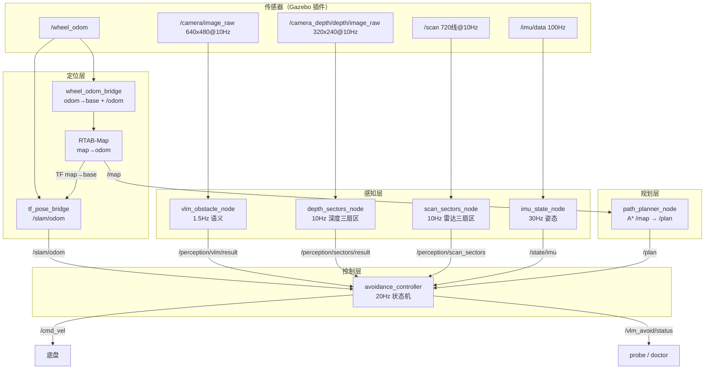

# 工程阅读指南（当前版本）

> 面向三类人：**想跑起来的人**、**想调参的人**、**想读懂代码的人**。
> 按顺序读这一份就够了；更深的原理在 [beginner_guide.md](beginner_guide.md)，
> 设计取舍在 [architecture.md](architecture.md)，实验记录在 README 第 10 节。

---

## 1. 这个工程是什么

Gazebo 里的差速小车，用 **相机 + 深度 + 360° 激光 + IMU** 做感知，
本地 VLM（Qwen2.5-VL）做语义判断，A* 做全局规划，最后输出 `/cmd_vel`。

三种能力叠在一起：

| 能力 | 靠什么 | 效果 |
|---|---|---|
| 看懂场景 | VLM（1.5 Hz，慢但懂语义） | 判断"前面是人/箱子/可通过" |
| 躲得开 | 深度扇区 + 雷达扇区（10 Hz） | 撞不上，0.15 m 停车 |
| 走得对 | RTAB-Map 建图 + A* 规划 | 指定目的地能绕墙过去 |

典型运行画面：rviz 里能看到实时地图、A* 路径、雷达点、相机图；
Gazebo 里小车绕开红箱、穿过隔墙缺口、到达目标点停下。

---

## 2. 怎么跑

### 2.1 三条命令

```bash
bash scripts/ollama_serve.sh      # ① 启动 VLM（手动，幂等）
bash scripts/run_sim.sh           # ② 仿真 + SLAM + 避障 + rviz
bash scripts/goal.sh 22 -6        # ③ 另开终端：给目的地
```

`ollama_stop.sh` 停止并释放显存；`bash scripts/rviz.sh` 只开 rviz。

### 2.2 三种定位模式（`localization:=`）

| 模式 | 位姿来源 | 地图 | 什么时候用 |
|---|---|---|---|
| `rtabmap`（默认） | RGB-D + 雷达 + 轮速，RTAB-Map 图优化 | SLAM 实时建 | 正常使用 |
| `slam` | 仓库内置 SLAM（雷达匹配 + IMU + 轮速 + VO） | 内置实时建 | 没装 rtabmap 时的零依赖备用 |
| `ground_truth` | Gazebo 真值位姿 | 离线地图 | 排障基准：真值也对不上 = 地图/坐标 bug |

```bash
bash scripts/run_sim.sh localization:=slam
bash scripts/run_sim.sh localization:=ground_truth
bash scripts/run_sim.sh gui:=false            # 不看 Gazebo 窗口
bash scripts/run_sim.sh vlm_model:=qwen2.5vl:7b
```

### 2.3 一分钟自检

```bash
python3 scripts/doctor.py               # 环境/依赖/话题一次性体检
python3 scripts/probe.py                # 实时看 状态/风险/净空/速度/目标距离
ros2 topic hz /map                      # SLAM 地图应约 1Hz
ros2 run tf2_ros tf2_echo map base_footprint   # 位姿在动 = TF 没冻结
bash scripts/run_tests.sh               # 100 个单测 + 8 阶段端到端
```

---

## 3. 运行时架构



### 3.1 为什么是这个频率

VLM 在 4060 上约 0.5–2 s/帧，**不能**参与实时避障。所以分两条通道：

- **语义通道（慢）**：VLM 判断"这是什么、危不危险"，风险值带时间衰减；
- **几何通道（快）**：深度 + 雷达 10 Hz 给左/中/右距离，直接决定急停和避让。

控制器把两路风险取 `max`、距离取 `min`。VLM 挂了就只剩几何通道，
日志里会出现 `仅深度通道`，车照常跑（降级限速）。

---

## 4. 参数怎么调

### 4.1 唯一入口：`tunable.json`

`src/vlm_avoid_bringup/config/tunable.json` 按节点分节，改完重启 launch 生效
（`--symlink-install`，不用重新编译）。

**优先级**：`avoidance.yaml` < `tunable.json` < launch 参数（`vlm_model:=` 等）。

> 键名写错会被静默忽略。改完跑 `bash scripts/run_tests.sh`，
> `tests/test_tunable_json.py` 会检查拼写和完整性。

### 4.2 最常调的几个（`avoidance_controller` 节）

| 参数 | 当前值 | 含义 |
|---|---|---|
| `cruise_linear` | 0.70 | 巡航速度 m/s |
| `max_linear` | 0.80 | 速度上限 |
| `creep_linear` | 0.12 | 避让时的爬行速度 |
| `avoid_angular` | 1.00 | 避让转向角速度 |
| `obstacle_distance` | 0.35 | 小于它开始避让 |
| `stop_distance` | 0.15 | 小于它立即停 |
| `release_margin` | 0.25 | 障碍解除的迟滞（释放 = 0.35+0.25） |
| `goal_tolerance` | 0.30 | 距目标多近算到达 |
| `goal_kp` / `goal_max_angular` | 1.40 / 0.90 | 到目标时的航向控制 |
| `stuck_recovery_time` | 1.4 | 卡住后倒退转向持续多久 |
| `lateral_swerve_max_angle` / `_time` | 0.4363 / 1.0 | 侧向避让预算（防绕圈） |

**调参思路**：先只动 `cruise_linear` 和 `obstacle_distance` 感受差别；
觉得"太怂"就把 `obstacle_distance` 调小（0.30），觉得"要撞"就调大（0.45）。

### 4.3 定位与规划

| 节点 | 关键参数 | 说明 |
|---|---|---|
| `path_planner_node` | `inflation_radius` 0.28 | A* 的障碍膨胀，太小蹭墙、太大过不了门 |
| | `replan_period` 2.0 | 多久按当前位置重算路径 |
| | `map_wait_timeout` 20 | 等不到 `/map` 就回退离线地图 |
| `slam_node` | `keyframe_dist` / `loop_radius` | 关键帧间距 / 回环搜索半径 |
| `vlm_obstacle_node` | `model` / `max_side` 384 | 模型与送进网络的图像边长（越小越快） |

换世界后**必须重新生成地图**（`ground_truth` 模式才用得到）：

```bash
python3 scripts/make_map_from_world.py --world <world> --out <json>
```

---

## 5. 代码地图

```
src/
├── vlm_control/                       控制与规划
│   ├── planner.py            (450)    ★ 状态机核心：CRUISE/AVOID/STOP/RECOVERY/GOTO
│   ├── controller_node.py    (406)    ROS 外壳：订阅、融合、发 /cmd_vel
│   ├── slam_core.py          (445)    ★ 内置 SLAM：扫描匹配 + 位姿图 + 占据栅格
│   ├── slam_node.py          (240)    SLAM 的 ROS 节点
│   ├── grid_map.py           (250)    ★ 栅格 + 膨胀 + A* + 平滑
│   ├── path_planner_node.py  (272)    A* 的 ROS 节点（/map → /plan）
│   ├── visual_odometry.py    (144)    ORB + PnP 视觉里程计
│   ├── imu_node.py           (92)     互补滤波
│   ├── ground_truth_odom.py  (136)    真值位姿 → /odom（对比实验用）
│   ├── wheel_odom_bridge.py  (80)     /wheel_odom → /odom + TF
│   └── tf_pose_bridge.py     (85)     TF → /slam/odom（接任意 SLAM 框架）
├── vlm_perception/                    感知
│   ├── vlm_client.py         (320)    提示词、JSON 容错解析、HTTP 调用
│   ├── vlm_node.py           (244)    工作线程，1.5Hz 单帧推理
│   ├── depth_sectors.py      (98)     ★ 深度 → 三扇区（含地面过滤）
│   ├── scan_sectors.py       (68)     雷达 → 三扇区
│   └── fake_camera.py        (255)    不开 Gazebo 时的假传感器
├── vlm_avoid_bringup/                 launch + 参数 + rviz
└── vlbot_gazebo/                      世界 + 机器人 spawn
```

**阅读优先级**：`planner.py` → `controller_node.py` → `grid_map.py` → `slam_core.py`。

---

## 6. 初学者阅读路径

按这个顺序，**每一步都要动手验证一下**，不然看完就忘。

### Step 0：先跑起来（10 分钟）

```bash
bash scripts/ollama_serve.sh
bash scripts/run_sim.sh
python3 scripts/probe.py
```

目标：看到 `probe` 里 `状态=CRUISE 风险=0.0x 净空=x.xx v=0.70`。
不清楚就翻 [setup.md](setup.md)。

### Step 1：搞懂一帧怎么走完全程（20 分钟）

读 `planner.py` 的 `update()`（约 200–450 行），对照这张表：

```
输入 vlm_risk / center / left / right
  ↓ 融合：risk = max(vlm, 几何)，distance = min(深度, 雷达)
  ↓ 分层判定：< 0.15 停 / < 0.35 避让 / 否则直行
  ↓ 平滑 + 限幅
输出 (linear, angular, state)
```

### Step 2：看控制节点怎么把 ROS 数据喂进去（20 分钟）

`controller_node.py` 的 `_tick()`：20 Hz，读 VLM/深度/雷达/IMU/位姿，
组装 `PlannerInputs`，调 `planner.update()`，发 `/cmd_vel` 和 `/vlm_avoid/status`。

**重点**：`odom_topic` 优先 `/slam/odom`，断了自动回退 `/wheel_odom`（限速 60%）。

### Step 3：A* 怎么绕墙（25 分钟）

`grid_map.py`：`world_to_cell` → `inflated()`（scipy 距离变换）→ `astar()`（8 邻域、
octile 启发、禁止切角）→ `smooth()`（视线法抽稀）。

动手：

```bash
python3 -c "
import sys; sys.path.insert(0,'src/vlm_control')
from vlm_control.grid_map import GridMap
m=GridMap.load('src/vlm_avoid_bringup/config/warehouse_map.json')
p=m.inflated(0.28).plan((1.5,1.5),(22,-6)); print(len(p),'个路点', p[:3])"
```

### Step 4：SLAM 为什么能修漂移（30 分钟）

`slam_core.py` 三个类：`OccupancyMap`（对数几率栅格）、`match_scan`（似然场由粗到精）、
`PoseGraph`（Gauss-Seidel 松弛 + 回环）。

不必看懂所有数学，只要理解：**扫描对扫描得到相对运动 → 位姿图连起来 → 回环把误差拉回**。

```bash
python3 scripts/slam_sim.py      # 离线跑一圈，看"漂移 1.65m → SLAM 0.30m"
```

### Step 5：VLM 那一层（20 分钟）

`vlm_client.py` 的提示词和 `normalize_result()`（模型输出会跑偏，要纠错），
`vlm_node.py` 的单帧工作线程（为什么是 1.5 Hz、为什么超时 60 s）。

### Step 6：自己改一个参数看效果（15 分钟）

改 `tunable.json` 里的 `cruise_linear` 为 0.4，重启，看 `probe` 的速度变化。
体会"参数 → 行为"的对应关系。

---

## 7. 踩过的坑（你多半也会遇到）

| 现象 | 真正原因 | 处理 |
|---|---|---|
| rviz 里机器人不显示 | `/robot_description` QoS 必须是 `Transient Local` | `avoid.rviz` 已设 |
| 机器人变白、不动（Gazebo 里在动） | TF 冻结（ICP 里程计失锁） | 已改轮式里程计 + RTAB-Map |
| 没有地图/没有路径/车不动 | RTAB-Map 把地图发到 `/rtabmap/map` | launch 里 `map_topic:=/map` |
| 路径穿墙 | 兜底离线地图和 SLAM 坐标系差 1.5 m | 已按出生点平移 |
| 车贴墙卡住 | 没有"卡住"判定 | 3 s 位移 < 8 cm → 倒退转向自救 |
| VLM 一直失败 | Ollama 没启动 | `bash scripts/ollama_serve.sh` |
| 改参数没生效 | 键名拼错被忽略 | `bash scripts/run_tests.sh` 会报 |

排障命令速查：

```bash
ros2 topic hz /camera/image_raw      # 传感器有没有出数
ros2 topic hz /map                   # SLAM 有没有建图
ros2 topic echo /plan --once | head -5   # A* 有没有路径
ros2 run tf2_ros tf2_echo map base_footprint  # 位姿是否在动
python3 scripts/doctor.py            # 一次性体检
```

---

## 8. 我想改 X，该动哪里

| 想做的事 | 改哪里 |
|---|---|
| 调速度/避让距离 | `tunable.json` → `avoidance_controller` |
| 换大模型 / 换提示词 | `vlm_model:=` 参数 / `vlm_client.py` 的 prompt |
| 换场景 | `scripts/run_sim.sh world:=<path>` + 重新生成地图 |
| 换 SLAM 框架 | `rtabmap_slam.launch.py`，下游只认 `/slam/odom` + `/map` |
| 加新的感知源 | 实现成 `SectorScan` 发布者，控制器已按"取 min"融合 |
| 接真车 | `use_sim_time:=false require_imu:=true`，换传感器/底盘话题 |

---

## 9. 测试与验证

```bash
bash scripts/run_tests.sh          # 100 单测 + 8 阶段端到端（约 30 s）
python3 tests/rtabmap_smoke.py     # 合成数据验证 RTAB-Map（需先起 launch）
python3 scripts/slam_sim.py        # 离线验证内置 SLAM 的定位精度
```

端到端测试覆盖：前进 → 避障 → 恢复 → IMU 急停 → VLM 挂掉降级 →
目的地 GOTO → ARRIVED → A* 绕墙。
